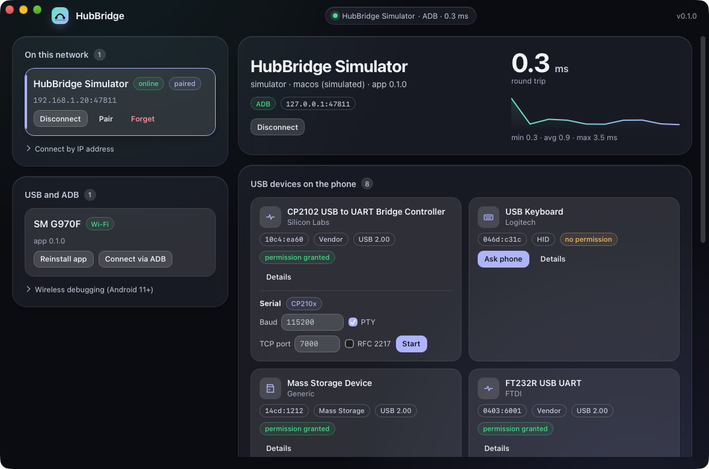

# HubBridge

**Turn an Android phone with a USB-C hub into a Wi-Fi/LAN bridge: the USB devices (and
later the displays and capture dongles) on the hub become usable from a macOS or Windows
computer.**

Android agent (Kotlin + Rust core) · desktop app for macOS and Windows (Rust) · MIT

[Русская версия](README.ru.md)

> Status: **first release, v0.1.0** (macOS and Android) — discovery, PIN pairing, encrypted
> sessions, USB device list with descriptors, hot-plug events and RTT over Wi-Fi/LAN and
> `adb forward`, a desktop window and a serial bridge (not yet tried with real adapters).
> More USB forwarding, video and the tray app come next ([roadmap](docs/ROADMAP.md)).

## Install

Download from [Releases](https://github.com/DeMoZ/HubBridge/releases). macOS builds are for
Apple Silicon (macOS 13 or later). There are no Windows downloads yet: on Windows, run HubBridge from
source only.

1. **macOS app.** Open `HubBridge-macOS-v<version>.dmg` and drag HubBridge to Applications.
   The app is signed ad hoc and not notarized, so on the first start macOS shows
   **"HubBridge" Not Opened** ("Apple could not verify…"). Press **Done**, open
   **System Settings → Privacy & Security** and press **Open Anyway** next to HubBridge (once
   per download). Or remove the download flag:
   `xattr -dr com.apple.quarantine /Applications/HubBridge.app`.
2. **Local network.** When macOS asks whether HubBridge may find devices on local networks,
   press **Allow**; without it the window does not find the phone.
3. **Phone app** (Android 8.0+). With USB debugging on, plug the phone in and press
   **Install app** in the window; the app is bundled inside. Or install
   `HubBridge-<version>.apk` yourself (`adb install HubBridge-<version>.apk`). A development
   build signed with another key must be uninstalled first, which forgets its paired
   computers.

**Command line only:** `hubbridge-<version>-macos-arm64.tar.gz` holds the `hubbridge` tool with
`HubBridge.apk` next to it, so `./hubbridge install-apk` works without options. If macOS
refuses to run it: `xattr -d com.apple.quarantine hubbridge`.

## How it works

```
 USB devices ─┐                        Wi-Fi / LAN (mDNS)              ┌─ hubbridge CLI / tray app
 capture card ─┼─ USB-C hub ─ Android ═══════════════════════════════ PC ─┤
 USB Ethernet ─┘      (phone is USB host)   or adb forward (dev)          └─ OS integration: USB/IP,
                                                                            serial PTY, virtual HID,
                                                                            virtual display / camera
```

- The phone runs **HubBridge** as a foreground service; a Rust core inside the app speaks
  the protocol, Kotlin handles `UsbManager`, permissions, NSD and the notification.
- The computer runs `hubbridge`, finds the phone on the LAN, pairs once with a 6-digit PIN,
  then opens encrypted sessions (SPAKE2 + Noise) automatically.

Read first: **[what works and what does not](docs/LIMITATIONS.md)** — e.g. a phone with one
USB-C port cannot host a hub and be cabled to the PC at the same time; the practical wired
link is a USB Ethernet adapter in the hub.

More: [architecture](docs/ARCHITECTURE.md) · [protocol](docs/PROTOCOL.md) ·
[roadmap](docs/ROADMAP.md).

## Desktop app

```bash
cargo run -p hubbridge-desktop --release      # opens the HubBridge window
```



- **On this network**: phones running HubBridge (mDNS), paired or not; Pair (PIN), Connect,
  Forget; connect by IP if mDNS is blocked.
- **USB and ADB**: phones seen by `adb` over the cable or Wi-Fi, grouped per phone; **Install
  app** / reinstall, **Connect via ADB**, **ADB over Wi-Fi** (so the phone can go on the hub
  and stay reachable by adb), Android 11+ wireless-debugging pairing by code.
- The connected phone: model, Android version, link (Wi-Fi / ADB), live round-trip time
  with a graph; reconnects by itself; remembers the last phone and connects at start.
- USB devices on the phone with configurations / interfaces / endpoints and **Ask phone**
  for USB permission.
- **Updates**: the version button in the top bar checks the GitHub releases. The app also checks
  by itself at most once a day (this can be turned off) and offers a new version, which you can
  install (**Update and restart**) or skip (**Skip this version**). Running serial bridges stop
  before the restart. Updating works only in the app from a release; a development build
  (`cargo run`) cannot update itself.
- **♥ Support**: ways to support the development; each one opens its payment page in the browser.

Uses the system WebView (tao + wry). adb is optional: needed only for the cable, installing
the app and ADB over Wi-Fi (`brew install android-platform-tools` on macOS).

## Try it without a phone

```bash
cargo run -p hubbridge-agent-sim -- --pin 123456        # terminal 1: fake agent
cargo run -p hubbridge-host -- discover                  # terminal 2
cargo run -p hubbridge-host -- pair 127.0.0.1 --pin 123456
cargo run -p hubbridge-host -- devices
cargo run -p hubbridge-host -- ping -c 20
cargo run -p hubbridge-host -- watch                     # add --churn 3 to the simulator
```

## With a phone

1. Build and install the app (Android 8.0+, USB host support):

   ```bash
   rustup target add aarch64-linux-android armv7-linux-androideabi x86_64-linux-android
   cargo install cargo-ndk
   cd android && ./gradlew installDebug     # builds the Rust core with cargo-ndk first
   ```

   Needs the Android SDK (`ANDROID_HOME` or `android/local.properties`), JDK 17+ and
   NDK 27: `sdkmanager "ndk;27.2.12479018"`.

   Or with the phone on USB (debugging on): `hubbridge install-apk` — takes the bundled
   `HubBridge.apk`, or the APK built in this checkout.

2. On the phone: open HubBridge → **Start: Wi-Fi/LAN + ADB** → **Pair a new computer**.
3. On the computer (same network):

   ```bash
   hubbridge discover
   hubbridge pair <name-or-ip> --pin <PIN from the phone>
   hubbridge devices
   hubbridge grant <device id>     # the phone asks for USB permission; tap Allow
   hubbridge watch
   ```

   Over a cable (phone connected to the PC, wireless debugging, or a two-port phone):
   `hubbridge pair adb --pin <PIN>`, then `hubbridge devices adb`.

## Commands

| Command | What it does |
|---|---|
| `hubbridge discover` | list agents on the LAN (mDNS) |
| `hubbridge pair <target> --pin N` | pair once; the key is saved in the user config dir |
| `hubbridge info [target]` | model, Android version, app and protocol versions |
| `hubbridge devices [target] [--json]` | USB devices with configurations, interfaces, endpoints |
| `hubbridge grant <id> [target]` | show the USB permission dialog on the phone |
| `hubbridge ping [target] -c N` | RTT min/avg/max/jitter through the encrypted session |
| `hubbridge watch [target]` | live device changes and RTT, reconnects on drops |
| `hubbridge install-apk [--serial S] [--apk F]` | install/update the app on a USB-connected phone and open it |
| `hubbridge adb [--serial S]` | set up `adb forward`, print the local address |
| `hubbridge agents` / `forget <agent>` | paired agents |

`target` is `adb`, `adb:<serial>`, `<ip>[:port]`, an agent name or id prefix; omitted = the
only paired agent. Logs: `HUBBRIDGE_LOG=debug`. Config dir override: `HUBBRIDGE_HOME`.

## Develop

```bash
cargo test --workspace
cargo clippy --workspace --all-targets
cargo fmt --all
```

## License

MIT
