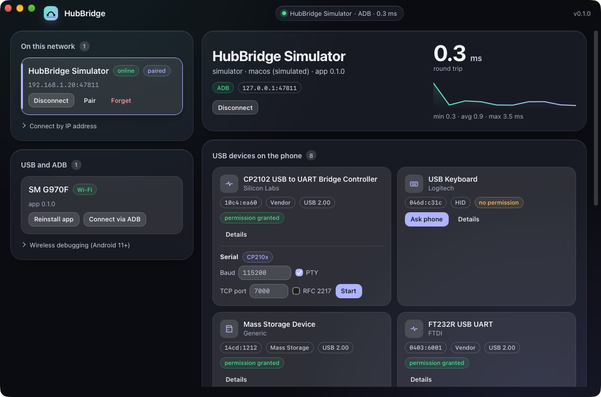

# HubBridge

**Android-смартфон с USB-C хабом превращается в мост по Wi-Fi/LAN: USB-устройства хаба (а
дальше и дисплеи, и карты захвата) становятся доступны на компьютере с macOS или Windows.**

Android-агент (Kotlin + ядро на Rust) · приложение для macOS и Windows (Rust) · MIT

[English version](README.md)

> Состояние: **шаг 1 из 4** — поиск в сети, сопряжение по PIN, шифрованные сессии, список
> USB-устройств с дескрипторами, события подключения/отключения и RTT по Wi-Fi/LAN и через
> `adb forward`. Дальше — проброс USB-данных, видео и приложение в трее
> ([план](docs/ROADMAP.md)).

## Сначала прочитайте

**[Что работает и что нет](docs/LIMITATIONS.md)**. Главное: у телефона с одним USB-C портом
этот порт либо хост для хаба, либо устройство для ПК — одновременно нельзя. Практичная
проводная связь — USB-Ethernet адаптер в хабе. Видео *в* телефон по USB-C не принимается
(DP Alt Mode у телефонов только на выход) — нужна UVC-карта захвата HDMI→USB.

Подробнее: [архитектура](docs/ARCHITECTURE.md) · [протокол](docs/PROTOCOL.md).

## Приложение для компьютера

```bash
cargo run -p hubbridge-desktop --release      # открывает окно HubBridge
```



Слева — телефоны в сети (сопряжение по PIN, подключение, подключение по IP) и телефоны по adb
(установка приложения, подключение через ADB, ADB по Wi-Fi, сопряжение беспроводной отладки по
коду). Справа — подключённый телефон с задержкой и графиком, автопереподключение, список его
USB-устройств с подробностями и кнопкой «Спросить телефон» для разрешения.

## Попробовать без телефона

```bash
cargo run -p hubbridge-agent-sim -- --pin 123456        # терминал 1: фейковый агент
cargo run -p hubbridge-host -- discover                  # терминал 2
cargo run -p hubbridge-host -- pair 127.0.0.1 --pin 123456
cargo run -p hubbridge-host -- devices
cargo run -p hubbridge-host -- watch
```

## С телефоном

1. `cd android && ./gradlew installDebug` (нужны Android SDK, JDK 17+, `cargo-ndk` и
   Android-таргеты Rust — см. README.md).
   Или, если телефон подключён по USB с включённой отладкой: `hubbridge install-apk` —
   поставит APK из поставки рядом с программой или собранный в этом репозитории.
2. На телефоне: HubBridge → **Start: Wi-Fi/LAN + ADB** → **Pair a new computer**.
3. На компьютере: `hubbridge discover`, `hubbridge pair <имя или IP> --pin <PIN>`,
   `hubbridge devices`, `hubbridge watch`. По кабелю: `hubbridge pair adb --pin <PIN>`.
