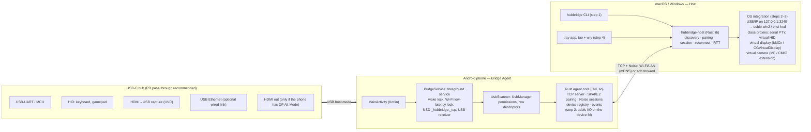

# HubBridge architecture

An Android phone sits on a USB-C hub with USB devices (and maybe displays / capture
dongles). HubBridge makes those devices usable from a macOS or Windows computer over
Wi-Fi/LAN, or through `adb forward` while developing.



## Components

### 1. Android Bridge Agent (`android/` + `crates/android` + `crates/agent`)

| Part | Language | Job |
|---|---|---|
| `MainActivity` | Kotlin | Start/stop, Wi-Fi+ADB or ADB-only mode, PIN for pairing, device list, paired computers. Receives `USB_DEVICE_ATTACHED` so the user can tick "always open HubBridge" (persistent per-device permission). |
| `BridgeService` | Kotlin | Foreground service of type `connectedDevice` with an ongoing notification. Holds a partial wake lock and a `WIFI_MODE_FULL_LOW_LATENCY` lock, registers `_hubbridge._tcp` with `NsdManager`, listens for attach/detach/permission broadcasts, asks for USB permission when a host requests it. |
| `DisplayWatcher` | Kotlin | Presentation displays (monitors on the USB-C port or hub) and the Samsung DeX flag as JSON, on every `DisplayListener` event. |
| `MirrorOutput`, `MirrorPresentation`, `MirrorDecoder` | Kotlin | The video output of a mirror: a `Presentation` on the monitor opened by the service (needs DeX off) with a surface of the stream's shape between black bars, and a `MediaCodec` H.264 decoder in low-latency mode rendering the newest picture. A window that Android cancels while the monitor is still there (a mode change) is opened again, with a new decoder, a limited number of times. Start refusals, lost surfaces and decoder errors go back to the agent. |
| `UsbScanner` | Kotlin | Builds the device list from `UsbManager`: ids, class, configurations, interfaces, endpoints; with permission also the serial and the raw descriptors (`UsbDeviceConnection.getRawDescriptors()`). |
| `NativeAgent` / `crates/android` | Kotlin ↔ Rust (JNI) | Thin JSON bridge; Rust calls back `onPermissionRequested` / `onStatusChanged`, USB open/close, and for mirrors `onMirrorStart` / `onVideoFrame` / `onMirrorStats` / `onMirrorStop` (the video output behind the agent's `VideoSink`). |
| `crates/agent` | Rust | TCP server (dual-stack `[::]` in LAN mode, `127.0.0.1` in ADB-only mode), pairing window (6-digit PIN, 120 s, 3 attempts), paired hosts store, sessions, device registry with diff → `DeviceAdded`/`DeviceRemoved` events, idle timeout; phone displays and mirroring (below). |

**Displays and mirroring in `crates/agent`** (`video.rs`; messages in [PROTOCOL.md](PROTOCOL.md)):

- `Agent::set_displays` takes the platform's presentation displays; a changed list goes as
  `DisplaysChanged` only to sessions that sent `GetDisplays`.
- The platform's video output is the `VideoSink` trait (`start`, `frame`, `stats`, `stop`; only
  called from threads that may block); `fake::FakeVideoSink` checks the H.264 stream for the
  simulator and the tests. The platform reports back with `mirror_failed`, `request_keyframe` and
  `set_phone_locked`.
- Stream registry: one stream per display, bound to the control session and host id that started
  it. A media session is a second resumed session whose first request is `MirrorAttach`
  (`media: true` in the status JSON, so the phone does not count it as a computer). Its frames go
  to a sink thread through a queue of three; it sends acknowledgements, keyframe requests and a
  status every second.
- A stream ends exactly once (stop request, display removed, video session lost, not attached
  within 5 s, decoder stalled for 2 s or failed, the platform's report, the control session
  ending, agent shutdown): the sink is stopped, the owner gets `MirrorStopped` when the phone
  side ended it, and the media session closes.

Why the core is in Rust and not Kotlin: one implementation of the protocol and crypto
for both ends; and from step 2 the hot path (USB transfers) runs in Rust directly on the
usbfs file descriptor from `UsbDeviceConnection.getFileDescriptor()` — `USBDEVFS_SUBMITURB`
gives asynchronous, queued bulk/interrupt transfers and **isochronous** transfers, which the
Java `UsbDeviceConnection` API does not offer at all, without a JNI hop per packet.

### 2. Desktop host (`crates/host`)

- Library `hubbridge-host`: `discover()` (mDNS), `resolve()` (address / name / id / `adb`),
  `Client::pair` / `Client::connect` (tries every resolved address), request/response with
  ids, event stream, `ping()` RTT, `adb::forward()` (reuses an existing forward).
- Each session has one writer task that owns the socket's write half. `Client::submit`
  only puts the encoded frame into a bounded queue (64 frames) and waits only while it is
  full, so callers may time out or be aborted without harming the session; frames leave
  whole and in the order they were accepted. A write or read failure ends the session for
  every caller at once ("connection lost: <reason>", one `Disconnected` event); `close()`
  sends what is queued, then `Bye`, within 2 s.
- Key store `host.json` in the user config dir, owner-only permissions (Keychain /
  Credential Manager in step 4).
- Step 1 front end is the `hubbridge` CLI (`discover`, `pair`, `info`, `devices`, `grant`,
  `ping`, `watch`, `adb`, `agents`, `forget`, `usb`, `serial`, `displays`, `mirror`).
- `mirror/`: the screen mirror. `fit` (stream size), `pace` (at most two frames unacknowledged,
  latest picture wins, keyframe rules), `stats`, `annexb`, `session` (the second connection),
  frame sources (`macos/`: ScreenCaptureKit + VideoToolbox; `test_pattern`: a built-in clip;
  `synthetic`: fake frames for tests) and `cli` (the two commands). Step 4 adds a tray app on tao + wry +
  tray-icon (same stack as UsbMemoryChecker / 360Cleaner), talking to the same library.
- Targets macOS and Windows (the phone side is Android). There is no Linux platform.

### Desktop window (`crates/desktop`)

- One page, `src/ui/index.html`, compiled in with `include_str!`; Rust pushes the whole model
  as JSON (`window.onState`), the page sends `{"action": ...}` requests through `send()`.
  Never declare a top-level `ipc` in the page script (wry owns `window.ipc`).
- Look ("Ambient Glass", dark and light following the system): every color, type size, radius,
  elevation and duration is a token in the page's `:root` blocks, colors as literals. Dark is the
  base `:root`; the light set is written twice (the `prefers-color-scheme: light` media query and
  `:root[data-theme="light"]`) and the increased-contrast / reduced-transparency opaque overrides
  likewise (the reduced-transparency overrides take effect in WebView2 on Windows only; macOS WebKit
  has no `prefers-reduced-transparency`, so the page relies on `prefers-contrast: more`, Increase contrast). Tests in `src/main.rs` keep the copies equal, check WCAG contrast of the real surface
  stacks (text on cards, chips, buttons, placeholders), allow only plain tokens as text colors, and
  guard that the page declares no top-level `ipc` and loads nothing from the network.
- `data-theme` on `<html>` forces a theme: `HUBBRIDGE_DEV_SCRIPT="document.documentElement.dataset.theme='light'"`
  (or `'dark'`) is how screenshots of both themes are made.
- Sheets use `openSheet(id)` / `closeSheet(id)`: Escape and a backdrop click close them, the rest of
  the page is `inert` while one is open, and focus returns to the opener. Content re-rendered with
  `put()` inside a panel or a sheet never drops the focus to the body: it stays on the same control
  or moves to the heading (a test checks every `put()` host).
- One-shot events go through the same model push as everything else. `update.offer` is a counter:
  the page opens the update sheet when it sees the value grow. `update.failed_launch` (the process
  got `--update-failed`) makes the page show its toast once.
- Modules besides the controller: `net.rs` (the system `curl`, so the app carries no TLS library;
  opens only `https://` links), `update.rs` (latest GitHub release, SHA-256 check against the
  published digest, unpacking, the bundle id check, the script that replaces the app after it quits)
  and `donations.rs` (the Support sheet's list). The saved donations list lives in the HubBridge
  config folder (or in `HUBBRIDGE_HOME`); the update download (`HubBridge-update-<version>`,
  removed after the install or when it fails) and the replace script (`HubBridge-update.sh` /
  `.ps1`) are in the system temp folder.
- **Phone displays and mirroring** (`app/mirroring.rs`): the right column shows "Phone displays"
  between the connection and the USB devices. `Model.displays` (`DisplaysView`: `supported`, the
  list, the DeX flag) is filled after a connect, only when the phone app passes the version gate, and
  follows `DisplaysChanged`. `Model.mirror` is a `MirrorView` (`idle | starting | running | stopped |
  failed`, display, stream size, fps, the readout, the reason, `phone_locked`, and `permission`, a
  counter that makes the page open the Screen Recording sheet when it grows). Requests:
  `mirror_start {display_id, fps}`, `mirror_stop`, `open_screen_settings`. The last one opens only
  the fixed address `x-apple.systempreferences:com.apple.preference.security?Privacy_ScreenCapture`
  with `/usr/bin/open`; the page cannot pass another. A start checks the Screen Recording permission
  first; "mirror" is a busy key that is refused once the app closes for an update, and an update waits
  for a start in progress like for a starting bridge. The readout reaches the model once a second.
  A disconnect, a quit (`LoopDestroyed`) and an update stop the mirror before the session closes; a
  lost connection ends it with its reason, and a reconnect does not start it again. One mirror at a
  time. Capture and encoder callbacks run on their own queues and never touch the WebView. On
  Windows the panel lists the displays and says that mirroring needs macOS for now.
- In a checkout on a case-insensitive disk (the macOS default) `target/debug/hubbridge` (CLI) and
  `target/debug/HubBridge` (window) are one file: the package built last wins. Build the one you are
  about to run (`cargo run -p hubbridge-host -- …` / `cargo run -p hubbridge-desktop`).
- Updating works only in a release build that runs from `HubBridge.app` (or the `.exe` folder on
  Windows). It is refused while the phone app is being installed or a pairing runs. After the last
  such check no APK install, pairing or bridge start can begin; bridges still starting are waited
  for (30 s at most), then all bridges are stopped and the phone is disconnected before the app
  quits. For checks,
  `HUBBRIDGE_UPDATES_URL` (`https://` only) replaces the address of the latest release.
- The release notes are shown in the update window up to the first "Install" / "Установка" heading,
  so those sections come last in `docs/releases/v<version>.md`.
- `crates/desktop/assets/donations.json` (the built-in copy) and `hubbridge.json` in
  [DeMoZ/donations](https://github.com/DeMoZ/donations) must be identical. The window downloads the
  latter every time the Support sheet opens (raw.githubusercontent.com, then jsDelivr) and keeps the
  last usable copy as `donations.json` in the config folder.
- The app icon is drawn by `scripts/make-icon.swift`; `scripts/make-icon.sh` writes
  `crates/desktop/assets/icon.png` and `AppIcon.icns` (macOS only, outputs are committed). The Android
  launcher icon is an adaptive icon with the same mark.

### 3. OS integration layer (steps 2–3, design)

**USB devices — two paths:**

1. **Generic: USB/IP.** The phone acts as the USB/IP *server* (exports the device; URBs are
   executed on usbfs). The host app opens a local USB/IP endpoint on `127.0.0.1:3240` and
   tunnels it over the encrypted HubBridge session, then attaches with the OS client:
   - Windows: [usbip-win2](https://github.com/vadimgrn/usbip-win2) — its recent releases ship
     attestation-signed drivers, so no test-signing mode is needed (older builds and forks
     needed it);
   - macOS: no USB/IP client exists. A virtual host controller needs Apple's
     `IOUSBHostControllerInterface` with the restricted entitlement
     `com.apple.developer.usb.host-controller-interface`, granted only on request. Plan for
     macOS without it → class proxies below.
2. **Class proxies** (no kernel driver, per device class):
   - CDC-ACM / FTDI / CP210x / CH34x serial (built, step 2b) → the chip logic runs **on the
     host** over the generic step 2a transfers (`crates/host/src/serial`): the encoders for
     each chip are pure functions checked against the Linux drivers, the agent stays
     chip-agnostic and needs no update per chip. The port core keeps several bulk IN
     transfers in flight, writes OUT transfers in order and reads modem status from the
     interrupt endpoint (CDC-ACM, CH34x), the in-band header (FTDI) or polling (CP210x). Front
     ends: a pseudo-terminal (macOS `openpty` → `/dev/ttysNNN`), a raw TCP port and an
     RFC 2217 TCP port (macOS and Windows; a Windows virtual COM port would need a signed driver
     such as com0com and is not shipped). A planned *generic* agent-side IN stream (chip
     agnostic, keeps IN transfers queued on the phone) is the option if UART adapters turn
     out to lose bytes at high baud rates over Wi-Fi; see LIMITATIONS "Serial over Wi-Fi";
   - HID → report descriptors + interrupt IN reports forwarded; the host injects via a virtual
     HID device (macOS HIDDriverKit dext, DriverKit entitlements + user approval; Windows VHF
     driver or ViGEm-style gamepad driver) or, for keyboards/mice only, synthesized input
     events (`CGEvent` / `SendInput`, no driver);
   - Mass storage → better exported as a file share (SMB/WebDAV from the phone) than
     block-level over Wi-Fi.

**Video:**

- (a) **PC → phone / hub display:** the host creates a virtual monitor
  (Windows: Indirect Display Driver, IddCx, UMDF — signing required, see LIMITATIONS;
  macOS: `CGVirtualDisplay` — private API, used by DeskPad/BetterDisplay), captures it
  (Windows.Graphics.Capture / Desktop Duplication; ScreenCaptureKit), encodes H.264/HEVC in
  hardware (Media Foundation with NVENC/QSV/AMF; VideoToolbox low-latency rate control), and
  streams to the phone. The phone decodes with `MediaCodec` (`KEY_LOW_LATENCY`) onto a
  `SurfaceView` on its own screen, or on the hub's HDMI output through the `Presentation`
  API when the phone exposes that output as a real secondary display (DP Alt Mode).
- (b) **Capture dongle on the hub → PC:** UVC device read on the phone either through
  Camera2 (Android 14+ external camera, when the OEM enabled it) or in user space on the usbfs
  fd (libuvc-style, isochronous or bulk). MJPEG frames are forwarded as is, or YUY2/NV12 is
  encoded with `MediaCodec` to H.264/HEVC. On the PC the stream is shown in the host app and
  exposed as a webcam: Windows 11 `MFCreateVirtualCamera` (no driver), macOS CoreMediaIO
  Camera Extension (system extension, Developer ID + notarization, user approval).

## Transport and protocol

- **TCP now, for everything.** `adb forward` only forwards TCP, and USB data needs
  reliable ordered delivery anyway.
- **Security:** PIN pairing with SPAKE2 (no offline brute force of the 6-digit PIN), then
  per-session Noise `NNpsk0_25519_ChaChaPoly_BLAKE2s` with the long-term key — mutual
  authentication, encryption, forward secrecy. Details in [PROTOCOL.md](PROTOCOL.md).
- **Video (step 3):** a second TCP connection to the same port, an ordinary resumed session
  that attaches itself to a mirror stream, for Wi-Fi/LAN and `adb forward` alike. A large
  frame never waits in front of a ping or a USB reply, there is one code path and no second
  encryption stack. A stall on Wi-Fi stops the picture; the two-frame acknowledgement window
  keeps the delay from growing. QUIC with unreliable datagrams (a lost packet would cost one
  frame, not a stall) stays a later option if measurements call for it.
  WebRTC is not needed: there is no NAT to traverse on a LAN, and its stack is heavy.

## Repository layout

```
HubBridge/
├── Cargo.toml                 Rust workspace
├── crates/
│   ├── proto/                 wire types, USB model, descriptor parser, fixtures (no I/O)
│   ├── link/                  record layer, SPAKE2 pairing, Noise sessions (tokio)
│   ├── agent/                 agent core: server, pairing window, sessions, device registry
│   ├── android/               JNI cdylib libhubbridge_android.so (built with cargo-ndk)
│   ├── agent-sim/             desktop agent with fake devices (CP210x/FTDI/CH340/CDC-ACM UARTs, keyboard, flash drive)
│   ├── host/                  desktop library + `hubbridge` CLI, e2e tests
│   │   └── src/mirror/        screen mirroring: fit, Annex B, pacing, stats, session, frame sources
│   └── desktop/               desktop window `HubBridge` (tao + wry): phones, pairing, adb, devices
│       ├── src/               app.rs (controller), app/mirroring.rs, net.rs, update.rs, donations.rs,
│       │                      ui/index.html
│       └── assets/            app icon: icon.png (1024), AppIcon.icns (made by scripts/make-icon.sh);
│                              donations.json: built-in copy of the Support list
├── android/                   Gradle project (AGP 9, Kotlin, no AndroidX)
│   └── app/src/main/kotlin/com/demoz/hubbridge/
│       ├── MainActivity.kt    UI
│       ├── BridgeService.kt   foreground service, locks, NSD, USB events
│       ├── UsbScanner.kt      UsbManager → JSON
│       ├── DisplayWatcher.kt  presentation displays → JSON
│       ├── Mirror*.kt         video output on the monitor: window, decoder, running streams
│       ├── NsdAdvertiser.kt   _hubbridge._tcp
│       └── NativeAgent.kt     JNI declarations
├── scripts/                   make-icon.sh / make-icon.swift: redraw the app icon (macOS);
│                              build-macos.sh: .app, .dmg, update zip, CLI archive; version.sh: the version
├── docs/                      ARCHITECTURE, LIMITATIONS, PROTOCOL, ROADMAP, RELEASING
│   └── releases/              release notes, one v<version>.md per release
└── .github/workflows/
    ├── ci.yml                 fmt, clippy, tests on macOS and Windows; APK
    └── release.yml            a v* tag builds and publishes the release (see RELEASING.md)
```

Releases (version, signing, files) are described in [RELEASING.md](RELEASING.md).

Planned additions: `crates/usbio` (usbfs URB engine on Android, step 2), `crates/usbip`
(USB/IP codec + localhost server, step 2),
`os/windows/idd` and `os/macos/` (driver/extension
projects, step 3).
