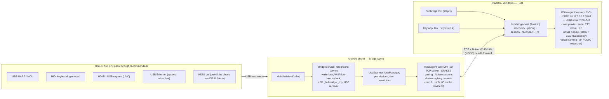

# HubBridge architecture

An Android phone sits on a USB-C hub with USB devices (and maybe displays / capture
dongles). HubBridge makes those devices usable from a macOS or Windows computer over
Wi-Fi/LAN, or through `adb forward` while developing.



## Components

### 1. Android Bridge Agent (`android/` + `crates/android` + `crates/agent`)

| Part | Language | Job |
|---|---|---|
| `MainActivity` | Kotlin | Start/stop, Wi-Fi+ADB or ADB-only mode, PIN for pairing, device list, paired computers. Receives `USB_DEVICE_ATTACHED` so the user can tick "always open HubBridge" (persistent per-device permission). |
| `BridgeService` | Kotlin | Foreground service of type `connectedDevice` with an ongoing notification. Holds a partial wake lock and a `WIFI_MODE_FULL_LOW_LATENCY` lock, registers `_hubbridge._tcp` with `NsdManager`, listens for attach/detach/permission broadcasts, asks for USB permission when a host requests it. |
| `UsbScanner` | Kotlin | Builds the device list from `UsbManager`: ids, class, configurations, interfaces, endpoints; with permission also the serial and the raw descriptors (`UsbDeviceConnection.getRawDescriptors()`). |
| `NativeAgent` / `crates/android` | Kotlin ↔ Rust (JNI) | Thin JSON bridge; Rust calls back `onPermissionRequested` / `onStatusChanged`. |
| `crates/agent` | Rust | TCP server (dual-stack `[::]` in LAN mode, `127.0.0.1` in ADB-only mode), pairing window (6-digit PIN, 120 s, 3 attempts), paired hosts store, sessions, device registry with diff → `DeviceAdded`/`DeviceRemoved` events, idle timeout. |

Why the core is in Rust and not Kotlin: one implementation of the protocol and crypto
for both ends; and from step 2 the hot path (USB transfers) runs in Rust directly on the
usbfs file descriptor from `UsbDeviceConnection.getFileDescriptor()` — `USBDEVFS_SUBMITURB`
gives asynchronous, queued bulk/interrupt transfers and **isochronous** transfers, which the
Java `UsbDeviceConnection` API does not offer at all, without a JNI hop per packet.

### 2. Desktop host (`crates/host`)

- Library `hubbridge-host`: `discover()` (mDNS), `resolve()` (address / name / id / `adb`),
  `Client::pair` / `Client::connect` (tries every resolved address), request/response with
  ids, event stream, `ping()` RTT, `adb::forward()` (reuses an existing forward).
- Each session has one writer task that owns the socket's write half. `Client::submit`
  only puts the encoded frame into a bounded queue (64 frames) and waits only while it is
  full, so callers may time out or be aborted without harming the session; frames leave
  whole and in the order they were accepted. A write or read failure ends the session for
  every caller at once ("connection lost: <reason>", one `Disconnected` event); `close()`
  sends what is queued, then `Bye`, within 2 s.
- Key store `host.json` in the user config dir, owner-only permissions (Keychain /
  Credential Manager in step 4).
- Step 1 front end is the `hubbridge` CLI (`discover`, `pair`, `info`, `devices`, `grant`,
  `ping`, `watch`, `adb`, `agents`, `forget`). Step 4 adds a tray app on tao + wry +
  tray-icon (same stack as UsbMemoryChecker / 360Cleaner), talking to the same library.
- Targets macOS and Windows (the phone side is Android). There is no Linux platform.

### 3. OS integration layer (steps 2–3, design)

**USB devices — two paths:**

1. **Generic: USB/IP.** The phone acts as the USB/IP *server* (exports the device; URBs are
   executed on usbfs). The host app opens a local USB/IP endpoint on `127.0.0.1:3240` and
   tunnels it over the encrypted HubBridge session, then attaches with the OS client:
   - Windows: [usbip-win2](https://github.com/vadimgrn/usbip-win2) — its recent releases ship
     attestation-signed drivers, so no test-signing mode is needed (older builds and forks
     needed it);
   - macOS: no USB/IP client exists. A virtual host controller needs Apple's
     `IOUSBHostControllerInterface` with the restricted entitlement
     `com.apple.developer.usb.host-controller-interface`, granted only on request. Plan for
     macOS without it → class proxies below.
2. **Class proxies** (no kernel driver, per device class):
   - CDC-ACM / FTDI / CP210x / CH34x serial (built, step 2b) → the chip logic runs **on the
     host** over the generic step 2a transfers (`crates/host/src/serial`): the encoders for
     each chip are pure functions checked against the Linux drivers, the agent stays
     chip-agnostic and needs no update per chip. The port core keeps several bulk IN
     transfers in flight, writes OUT transfers in order and reads modem status from the
     interrupt endpoint (CDC-ACM, CH34x), the in-band header (FTDI) or polling (CP210x). Front
     ends: a pseudo-terminal (macOS `openpty` → `/dev/ttysNNN`), a raw TCP port and an
     RFC 2217 TCP port (macOS and Windows; a Windows virtual COM port would need a signed driver
     such as com0com and is not shipped). A planned *generic* agent-side IN stream (chip
     agnostic, keeps IN transfers queued on the phone) is the option if UART adapters turn
     out to lose bytes at high baud rates over Wi-Fi; see LIMITATIONS "Serial over Wi-Fi";
   - HID → report descriptors + interrupt IN reports forwarded; the host injects via a virtual
     HID device (macOS HIDDriverKit dext, DriverKit entitlements + user approval; Windows VHF
     driver or ViGEm-style gamepad driver) or, for keyboards/mice only, synthesized input
     events (`CGEvent` / `SendInput`, no driver);
   - Mass storage → better exported as a file share (SMB/WebDAV from the phone) than
     block-level over Wi-Fi.

**Video:**

- (a) **PC → phone / hub display:** the host creates a virtual monitor
  (Windows: Indirect Display Driver, IddCx, UMDF — signing required, see LIMITATIONS;
  macOS: `CGVirtualDisplay` — private API, used by DeskPad/BetterDisplay), captures it
  (Windows.Graphics.Capture / Desktop Duplication; ScreenCaptureKit), encodes H.264/HEVC in
  hardware (Media Foundation with NVENC/QSV/AMF; VideoToolbox low-latency rate control), and
  streams to the phone. The phone decodes with `MediaCodec` (`KEY_LOW_LATENCY`) onto a
  `SurfaceView` on its own screen, or on the hub's HDMI output through the `Presentation`
  API when the phone exposes that output as a real secondary display (DP Alt Mode).
- (b) **Capture dongle on the hub → PC:** UVC device read on the phone either through
  Camera2 (Android 14+ external camera, when the OEM enabled it) or in user space on the usbfs
  fd (libuvc-style, isochronous or bulk). MJPEG frames are forwarded as is, or YUY2/NV12 is
  encoded with `MediaCodec` to H.264/HEVC. On the PC the stream is shown in the host app and
  exposed as a webcam: Windows 11 `MFCreateVirtualCamera` (no driver), macOS CoreMediaIO
  Camera Extension (system extension, Developer ID + notarization, user approval).

## Transport and protocol

- **TCP now, for everything.** `adb forward` only forwards TCP, and USB data needs
  reliable ordered delivery anyway.
- **Security:** PIN pairing with SPAKE2 (no offline brute force of the 6-digit PIN), then
  per-session Noise `NNpsk0_25519_ChaChaPoly_BLAKE2s` with the long-term key — mutual
  authentication, encryption, forward secrecy. Details in [PROTOCOL.md](PROTOCOL.md).
- **Video (step 3):** a second connection. Over Wi-Fi/LAN: QUIC (quinn) with unreliable
  datagrams for frames, so a lost packet costs one frame, not a head-of-line stall. Over
  `adb forward`: the same frames on a second TCP stream. Control stays on the first stream.
  WebRTC is not needed: there is no NAT to traverse on a LAN, and its stack is heavy.

## Repository layout

```
HubBridge/
├── Cargo.toml                 Rust workspace
├── crates/
│   ├── proto/                 wire types, USB model, descriptor parser, fixtures (no I/O)
│   ├── link/                  record layer, SPAKE2 pairing, Noise sessions (tokio)
│   ├── agent/                 agent core: server, pairing window, sessions, device registry
│   ├── android/               JNI cdylib libhubbridge_android.so (built with cargo-ndk)
│   ├── agent-sim/             desktop agent with fake devices (CP210x/FTDI/CH340/CDC-ACM UARTs, keyboard, flash drive)
│   ├── host/                  desktop library + `hubbridge` CLI, e2e tests
│   └── desktop/               desktop window `HubBridge` (tao + wry): phones, pairing, adb, devices
├── android/                   Gradle project (AGP 9, Kotlin, no AndroidX)
│   └── app/src/main/kotlin/com/demoz/hubbridge/
│       ├── MainActivity.kt    UI
│       ├── BridgeService.kt   foreground service, locks, NSD, USB events
│       ├── UsbScanner.kt      UsbManager → JSON
│       ├── NsdAdvertiser.kt   _hubbridge._tcp
│       └── NativeAgent.kt     JNI declarations
├── docs/                      ARCHITECTURE, LIMITATIONS, PROTOCOL, ROADMAP
└── .github/workflows/ci.yml   fmt, clippy, tests on macOS and Windows; APK
```

Planned additions: `crates/usbio` (usbfs URB engine on Android, step 2), `crates/usbip`
(USB/IP codec + localhost server, step 2), `crates/video` (framing, pacing, stats, step 3),
`os/windows/idd` and `os/macos/` (driver/extension
projects, step 3).
